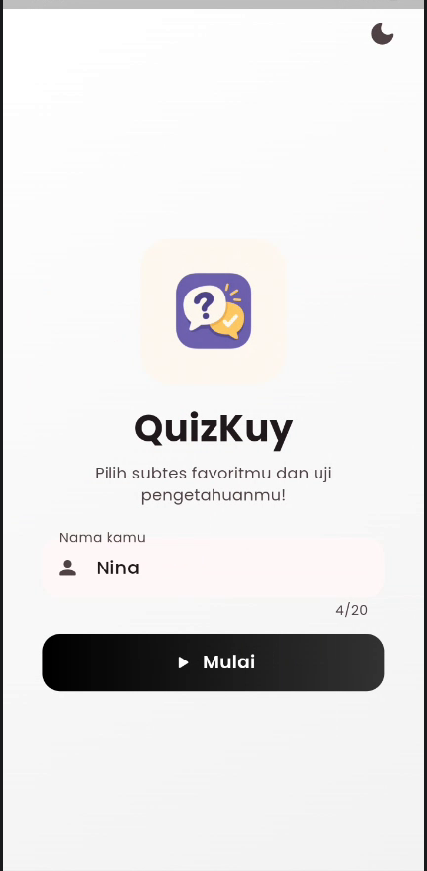
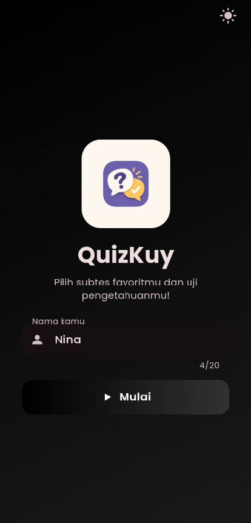
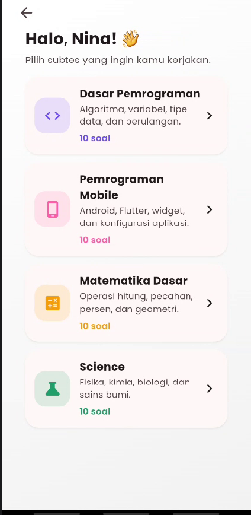
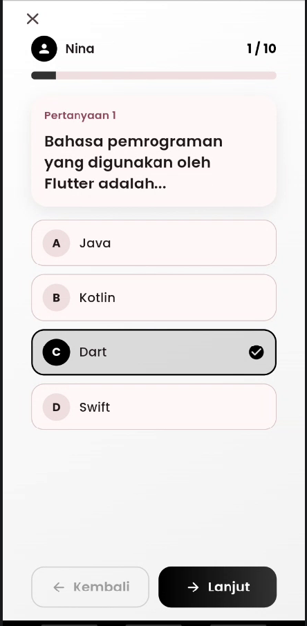
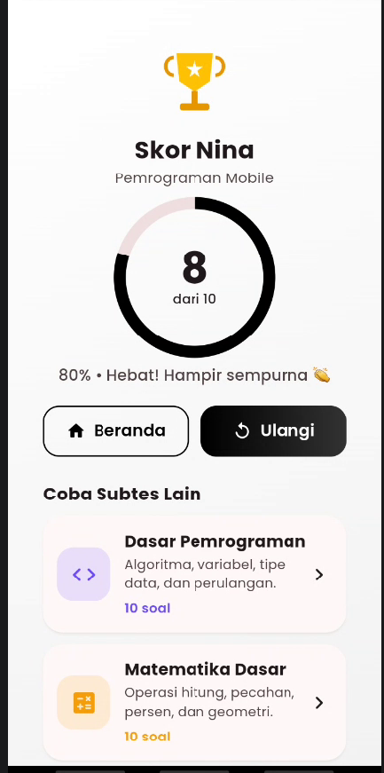
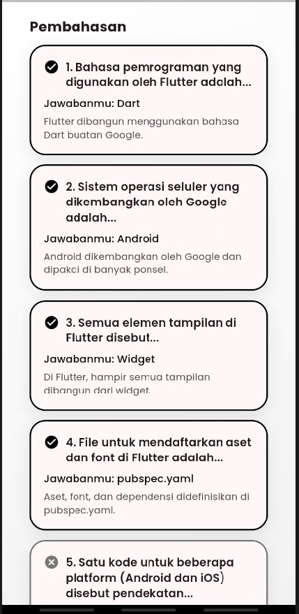

**Nama    : Badzlina Atika Salsabila**

**NIM     : 241401113**

**Lab     : 4**

**Asisten Laboratorium     : Muhammad Dzakwan Attaqiy**

**QuizKuy**

QuizKuy adalah aplikasi kuis pilihan ganda bertema pemrograman Flutter. Pengguna mengisi nama di halaman sambutan, menjawab 10 soal satu per satu dengan bar progres, lalu melihat skor akhir atas nama mereka beserta pembahasan setiap soal. Progres jawaban disimpan dengan state management sehingga tidak hilang saat layar dirotasi maupun saat berpindah halaman.

**Fitur-fitur**
* Input nama pengguna dengan validasi (nama tidak boleh kosong, maksimal 20 karakter).
* 10 soal pilihan ganda dengan data dummy lokal (tanpa database).
* Bar progres dan penanda nomor soal yang beranimasi.
* Navigasi antar soal (Kembali / Lanjut). Tombol Lanjut baru aktif setelah soal dijawab.
* Progres tersimpan: jawaban tidak hilang saat layar dirotasi atau pindah halaman, dan kuis bisa dilanjutkan dari tombol "Lanjutkan Kuis".
* Skor akhir atas nama pengguna dalam bentuk lingkaran skor beranimasi dan persentase.
* Pembahasan tiap soal: jawaban pengguna, jawaban benar, dan penjelasan.
* Ulangi kuis dan kembali ke beranda dari halaman hasil.
* Ukuran UI dinamis yang menyesuaikan ukuran layar, dengan lebar konten dibatasi agar tetap rapi di tablet dan browser.
* Mode gelap dan terang (dual-theme).

## c. Dokumentasi

### D. Credit Aset
* **Font Kustom:** Google Fonts (Poppins - Regular, Medium, SemiBold, Bold) yang didaftarkan melalui `pubspec.yaml`.

### E. Screenshot Tiap Halaman Aplikasi

* **Halaman Welcome / Input Nama (Light & Dark Mode)**
  

    
    
  

* **Halaman Pilihan Kategori / Subtest**
  

    
  

* **Halaman Kuis (Soal & Pilihan Ganda)**
  

    
  

* **Halaman Hasil & Pembahasan Kuis**
  

    
    
  

